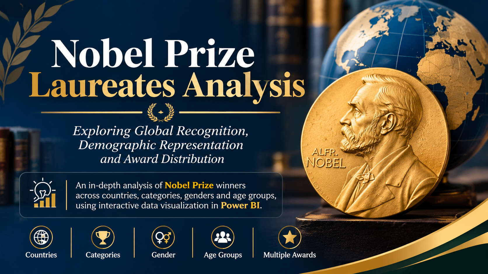
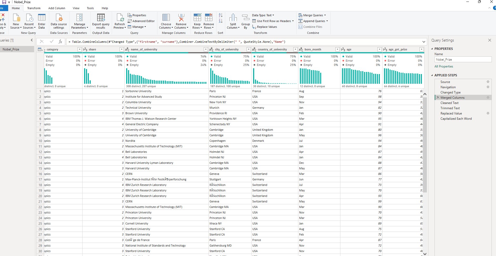
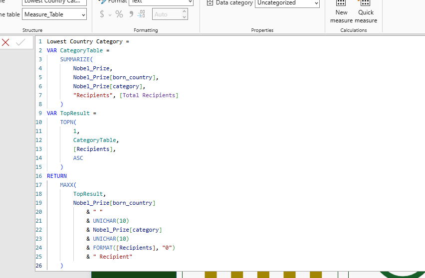
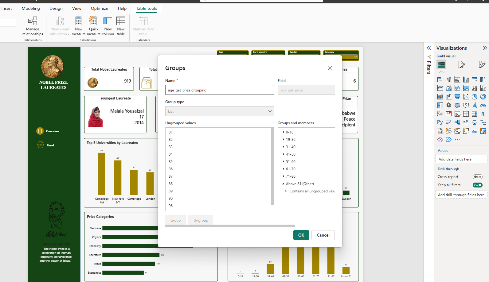
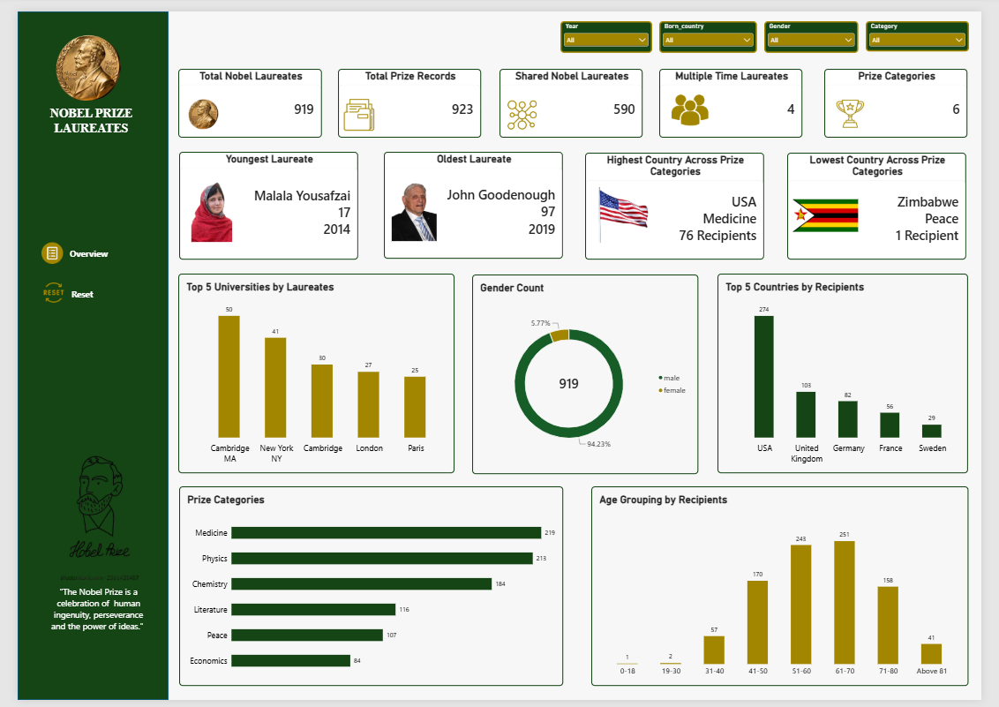

# Nobel Prize Laureates Analysis

## Introduction

This project presents an analysis of Nobel Prize laureates to explore the distribution of Nobel Prizes across different categories, countries, genders and age groups. The analysis examines historical patterns in Nobel Prize recognition, identifies countries with the highest representation and highlights demographic differences among recipients.
Using Microsoft Power BI, the data was analysed and presented through an interactive dashboard containing key performance indicators, charts, a geographical map and summary tables. The dashboard provides an overview of Nobel Prize distribution and allows users to explore patterns in recognition across different fields and demographic groups.
The analysis aims to provide a clearer understanding of how Nobel Prize recognition is distributed globally and identify areas where representation differs across countries, genders and age groups.

## About the Dataset

The dataset contains information on Nobel Prize laureates and their awards, including details relating to prize categories, award years, countries, gender and age at the time of receiving the award.
The dataset supports the examination of:
-	Laureate information: Individuals who have received Nobel Prizes.
-	Prize categories: Physics, Chemistry, Medicine, Literature, Peace and Economic Sciences.
-	Award records: The years in which Nobel Prizes were awarded.
-	Geographical distribution: Countries represented among Nobel laureates.
-	Demographic information: Gender and age distribution of recipients.
-	Multiple awards: Individuals who have received Nobel Prizes more than once.
An important distinction in the analysis is that the dashboard reports 919 individual laureates across 923 prize records. This means the number of prize records is higher than the number of individual recipients because some laureates received more than one Nobel Prize.

## Problem Statement

Although the Nobel Prize recognises achievements across several fields, understanding how recognition is distributed across countries, genders, age groups and prize categories requires a structured analysis of historical award records.
Without a consolidated view of these records, it can be difficult to identify the fields with the highest number of recipients, countries with the strongest representation, demographic differences and individuals who have received multiple awards.
This project therefore seeks to analyse Nobel Prize records to:
-	Determine the total number of laureates and prize records.
-	Identify the Nobel Prize category with the highest number of recipients.
-	Examine the geographical distribution of laureates across countries.
-	Analyse gender representation among Nobel Prize recipients.
-	Understand the age distribution of laureates when they received their awards.
-	Identify individuals who have received multiple Nobel Prizes.
-	Highlight patterns and representation gaps within the available records.
The findings provide a data-driven overview of Nobel Prize recognition and its distribution across different groups.

## Visualization

Power Query was used to prepare the Nobel Prize dataset for analysis in Power BI. The data transformation process involved reviewing the dataset, checking data types, handling missing or inconsistent values, merging columns and organising relevant columns for analysis. These steps helped improve data consistency and ensured that the dataset was properly structured for creating visualisations and DAX measures.

DAX (Data Analysis Expressions) was used in Power BI to create measures for calculating key performance indicators and summarising the Nobel Prize dataset. These measures supported the analysis of laureate distribution, prize categories, country rankings, gender representation, and multiple award recipients. The calculations also made the dashboard interactive, allowing results to respond to report filters and selections.

A calculated age-group classification was created using group list in Power Bi to organise Nobel laureates into meaningful age ranges. This made it easier to examine the ages at which individuals received Nobel Prizes and identify the age groups with the highest representation.

The data was analysed and visualised using Microsoft Power BI.

## Key Insights

The analysis revealed several patterns in the distribution of Nobel Prize recipients.
1. The United States has the highest number of laureates.
The United States recorded the highest number of Nobel Prize recipients, with 274 laureates. The United Kingdom followed with 114, Germany with 98, France with 66 and Japan with 57. This shows that Nobel Prize recipients in the dataset are concentrated in a relatively small number of countries.
2. Medicine has the highest number of recipients.
Medicine recorded the highest number of recipients, with 219, followed by Physics (213) and Chemistry (184). Economics had the lowest number, with 84 recipients. This indicates differences in the distribution of Nobel recognition across the six prize categories.
3. Male recipients account for the majority of laureates.
The gender distribution shows 869 male recipients (94.1%) compared with 54 female recipients (5.9%). This represents a substantial gender imbalance in the historical Nobel Prize records included in the dataset.
4. Most laureates received their awards between the ages of 51 and 70.
The age distribution shows that:
-	251 recipients were between 61 and 70 years old.
-	243 recipients were between 51 and 60 years old.
-	170 recipients were between 41 and 50 years old.
-	158 recipients were between 71 and 80 years old.
Together, recipients aged 51–70 account for approximately 53.8% of the laureates represented in the age distribution. This suggests that Nobel recognition in the dataset is concentrated among individuals in these age groups.
5. Some individuals have received multiple Nobel Prizes.
The dashboard identifies four notable multiple-prize recipients:
- Marie Curie – Physics (1903) and Chemistry (1911).
- Frederick Sanger – Chemistry (1958 and 1980).
-	Linus Pauling – Chemistry (1954) and Peace (1962).
-	John Bardeen – Physics (1956 and 1972).
These examples demonstrate that some individuals have received Nobel recognition for multiple contributions, including achievements in different fields.
6. The youngest and oldest laureates demonstrate a wide age range.
Malala Yousafzai was identified as the youngest laureate at age 17 when she received the Peace Prize in 2014. John Goodenough was identified as the oldest at age 97 when he received the Chemistry Prize in 2019.
This highlights the wide range of ages at which individuals have received Nobel recognition.
Source: Findings extracted from the Nobel Prize Winners Dashboard. 
Nobel Prize Winners Dashboard.png

## Further Recommendations

Based on the findings, the following recommendations are proposed:
1. Encourage greater gender representation.
The significant difference between male and female recipients highlights the need to encourage equal opportunities for recognition. Institutions, research organisations and award bodies should continue to support inclusive research environments and improve the visibility of contributions from women.
2. Strengthen international research collaboration.
The high concentration of laureates in the United States and other leading countries suggests an opportunity to strengthen research capacity and international collaboration in less-represented regions. Supporting research funding, education and scientific partnerships could help expand global participation in research and innovation.
3. Promote research development across all prize categories.
Although Medicine recorded the highest number of recipients, Economics had the lowest. Research institutions should continue supporting innovation and knowledge development across all disciplines rather than concentrating resources in a few fields.
4. Support early-career researchers.
The concentration of laureates within the 51–70 age groups highlights the value of sustained academic and professional development. Institutions should provide mentorship, research funding and opportunities for younger researchers to develop their work.
5. Maintain historical award records and monitor trends.
Nobel Prize records should be continuously updated and analysed to monitor changes in geographical distribution, gender representation and prize categories over time. This would make it easier to assess whether representation is becoming more balanced.
6. Explore the contributions of multiple-prize recipients.
Further research could examine the achievements, research backgrounds and career paths of individuals who have received multiple Nobel Prizes. This could provide additional insights into the nature of contributions recognised across different disciplines.

## Conclusion

The analysis of Nobel Prize laureates provides an overview of the distribution of global recognition across countries, prize categories, genders and age groups. The findings reveal that the United States has the highest number of recipients, Medicine leads the prize categories, and male recipients account for the overwhelming majority of laureates in the dataset. The analysis also identifies the age groups with the highest representation and highlights individuals who have received multiple Nobel Prizes.
The dashboard makes these patterns easier to understand through interactive visualisations and comparative analysis. However, the findings also reveal areas that deserve further attention, particularly gender representation and the geographical concentration of recipients.
Overall, this project demonstrates how data analytics can be used to organise historical records, identify patterns and communicate findings effectively. It also shows how Power BI can transform structured datasets into interactive reports that support exploration and informed interpretation.

